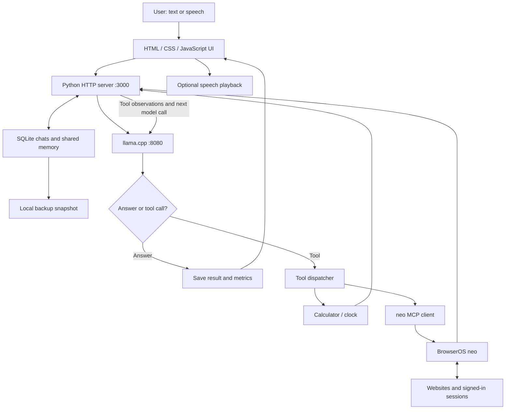

# Project vision, capabilities, access, and end-to-end operation

> Historical source review, written before the autonomous-browser upgrade. For the implemented task controller, enforced approvals, Stop/resume, policy-checked actions and live monitor, see [the implementation report](docs/AUTONOMOUS_BROWSER_IMPLEMENTATION.md). Its behavior supersedes the older browser-capability descriptions below.

Analysis date: 9 November 2026. This document describes the source code and local runtime observed during this review. Capabilities mean implemented paths, not a guarantee that every model will complete every requested task accurately.

## 1. What this application is

This project is a **personal AI assistant running on your Windows computer**, with a web chat interface, local language models, persistent conversations, shared memory, voice controls, and tools for operating BrowserOS neo.

Its core job is to turn a natural-language request into either a written answer or a series of browser actions followed by an answer. Model inference runs locally through llama.cpp. Live website work happens in a separate, persistent BrowserOS neo browser.

The clearest description of the current product is:

> A local conversational assistant for writing, understanding supplied text, researching websites, and performing bounded browser workflows using the user's browser access.

It is currently designed around one computer, one shared model runtime, one shared memory setting, and one browser connection. There is no user-account or organization separation.

### Current observed state

Read-only local API checks returned:

| Item | State during this review |
| --- | --- |
| Chat service | Responding at `http://127.0.0.1:3000` |
| Model service | Responding at `http://127.0.0.1:8080/v1` |
| Active model | `qwen3.5-4b-uncensored-hauhaucs-aggressive` |
| Active configured context | 65,536 tokens |
| Model input/output | Text input and text output, as reported by the runtime |
| Model tools | Enabled for the active model |
| Selectable model files | All four catalog models reported installed |
| neo configured ports | Proxy 9010, server 9210, CDP 9110 |

These checks establish service availability and configuration. They do not establish that neo is currently connected, any particular website is signed in, or a real task will succeed.

## 2. What kinds of jobs it can do

### A. Writing and working with supplied text

The model can answer questions, explain concepts, draft messages, rewrite text, summarize material, extract information from pasted HTML or prose, and produce code or structured text in its answer.

Examples:

- “Summarize these notes and list the unresolved decisions.”
- “Extract the product names and prices from this HTML.”
- “Rewrite this email in plain English.”
- “Explain this code and suggest a fix.”

These are model capabilities, with accuracy depending on the model and prompt. Producing code in chat does not execute it or edit a project. There is no attachment ingestion or document parser in the active chat flow; supply text directly or use readable website content.

### B. Live web research and information collection

With a tool-enabled model and neo available, it can open websites, search through a search-engine URL, read page text, inspect interactive elements, navigate links, and gather information for a summary or comparison. The system prompt asks it to cite visited URLs.

Examples:

- “Open this documentation page and explain the installation steps.”
- “Read these product pages and compare their listed specifications.”
- “Find the relevant section on this website and summarize it with links.”

There is no separate search API or search index. Search is a browser workflow. Page observations are shortened, so this is better suited to targeted research than exhaustive crawling.

### C. Website interaction and account workflows

The active browser tool describes support for opening and reusing tabs, navigation, reading, interactive snapshots, clicks, filling forms, pressing keys, selecting options, checking boxes, scrolling, and closing tabs.

This makes website workflows technically possible: search inside a site, filter a table, enter a form, navigate a dashboard, or submit a website action. If neo has an authenticated session, actions can use that session subject to website permissions and neo's restrictions.

**The app has no built-in approval checkpoint before a browser click or submission.** An action can send a message, publish content, modify a record, or trigger another consequential operation if the website exposes it. There are no dedicated integrations for these operations; they are conditional browser interactions. Human review must be part of the user's instructions when required.

Logins, CAPTCHA, two-factor authentication, inaccessible pages, changed layouts, stale references, and model mistakes can interrupt these jobs.

### D. Independent work across multiple tabs

`browser_parallel` accepts 1–5 tasks and runs them concurrently within a single neo script using `Promise.all`.

Supported task actions are `read`, `snapshot`, `click`, `fill`, `press`, and `scroll`. Each task targets a new HTTP/HTTPS URL or a distinct existing tab owned by the connection. Results contain the tab ID, timings, snapshot, optional page text, and any task error.

Example: “Read these three URLs in parallel, then compare the results.” A second batch can interact using the references returned by the first batch.

The colored pointers are visual overlays inside pages. They are not Windows mouse cursors. Parallel tabs do not create multiple models, separate assistants, separate accounts, or isolated browser profiles. Tabs share the browser's underlying account sessions. Dependent actions in one tab must remain sequential.

### E. Arithmetic and time

`calculate` performs one operation on two finite numbers: add, subtract, multiply, or divide. Inputs are validated; division by zero becomes a tool error. This is not a spreadsheet, expression interpreter, statistical engine, or arbitrary Python tool.

`current_time` returns this computer's local date and time with UTC offset. It does not create reminders or calendar events.

### F. Persistent conversations and user memory

Users can create, reopen, search by title, delete, and export conversations. The application saves messages, drafts, results, tool records, and metrics. A user-editable “Memory across chats” field supplies preferences or context to saved conversations.

This is prompt-based memory. It does not train the model or modify its weights. Shared memory is manually maintained; the application does not automatically extract facts into that field. Older conversation context can be summarized automatically, while original messages remain stored.

### G. Voice interaction

Dictation converts speech into composer text for review. Voice chat automatically submits a final transcript, speaks the completed response, and listens again after playback.

It uses browser speech recognition and speech synthesis, not a bundled speech model. Language and voice availability depend on browser/OS support. Recognition may use an online service. Voice mode pauses during replies/playback and stops when the tab is hidden, the chat changes, a model is loaded, or relevant errors occur. Silence without a transcript requires another explicit start. Code and tables are excluded from spoken replies.

## 3. Exactly what access it has

The application's access must be distinguished from the access of the development assistant inspecting this repository. This application only exposes the tools registered in `chat_tools.py` to its model.

| Resource | Implemented access | Boundary |
| --- | --- | --- |
| Conversation data | Backend reads/writes SQLite chats, drafts, summaries, and memory | No per-user isolation or app-level encryption |
| Browser websites | neo SDK scripts can observe and act on accessible pages | Subject to neo SDK, browser, website, and account restrictions |
| Signed-in website accounts | Can potentially act through sessions present in neo | Not automatically the accounts from Chrome, Edge, or another browser |
| Public internet | Through browser navigation; setup downloads use curl | No general model-facing network request tool |
| Local/intranet websites | Potentially reachable through the browser's network access | No app-level public-host allowlist; actual reachability unverified |
| Local files | App itself accesses its code, models, logs, database, and artifacts | No registered general-purpose file read/write tool for the model |
| Shell/processes | Backend launches its allowlisted llama.cpp process; setup runs curl | Model cannot request arbitrary PowerShell, Python, or shell execution through a registered tool |
| Microphone | Chat UI can request browser microphone access for speech recognition | Requires browser permission and recognition support |
| Speakers | Browser speech synthesis reads replies | Depends on available voices |
| Clipboard | UI copy buttons write selected response/code text | No model-facing arbitrary clipboard reader |
| Windows desktop | No active desktop-control integration | Browser page pointers do not control native apps |
| Email/calendar/Drive | No native OAuth connector or service SDK integration | Browser interaction may work if the service is accessible and authenticated |
| Files for download/screenshots | Legacy artifact route and rendering support exist | Current neo path does not provide the legacy download/screenshot pipeline automatically |

The single-tab browser tool accepts SDK JavaScript rather than a narrow list of action objects. Its tool description discourages `fetch`, `require`, `process`, and direct page globals. The Python wrapper does not parse JavaScript to enforce those restrictions; the actual execution boundary is neo's sandbox and supported SDK. The parallel implementation uses page evaluation and CDP for pointer rendering and element geometry.

There is no app-level domain permission list, action risk classifier, browser write confirmation, or per-conversation browser isolation. The “use your own tabs” instruction in the general browser tool is prompt guidance. The parallel path additionally checks ownership for existing tabs.

## 4. Models and compute

`model_runtime.py` defines the actual selectable catalog:

| Key | Model | Configured context | GPU layers | App tools |
| --- | --- | ---: | --- | --- |
| `qwen4b` | Qwen3.5 4B Uncensored HauhauCS Aggressive Q4_K_M | 65,536 | All | Enabled |
| `qwen9b` | Qwen3.5 9B Q4_K_M | 16,384 | All | Enabled |
| `wizard7b` | WizardLM 7B Uncensored Q4_K_M | 2,048 | All | Disabled |
| `qwen30b` | Qwen3 30B A3B Abliterated Erotic IQ3_XS | 4,096 | 18 | Enabled |

“Enabled” means the application supplies tool schemas. It does not prove reliable tool use by that model variant.

Only one model runs at a time, with one llama.cpp generation slot. A shared lock serializes chat generation, model changes, and chat deletion; conflicting operations return HTTP 409. Parallel browser tasks happen inside that one conversation request.

`python start.py` defaults to Qwen 4B. `start.ps1` and direct `python server.py` default to Qwen 9B unless configured otherwise. The Gemma model file exists on disk but is absent from the selectable catalog.

WizardLM uses `templates/vicuna.jinja` and a `USER:` stop sequence. It receives no tools or thinking setting. Other models receive the thinking template flag; the UI defaults to thinking off and hides it for WizardLM. Hidden reasoning is not displayed.

The 30B weights exceed the documented 8 GB GPU capacity and use partial offload plus system RAM. Performance and task quality have not been benchmarked in this review. Model names such as “uncensored” describe variants; they do not add access or guarantee accuracy.

## 5. Architecture and end-to-end flow

### Step 1: Setup and startup

`setup_local.py` downloads pinned model/runtime files with resumable curl requests and verifies SHA-256 before promoting partial files. Default setup installs the llama.cpp CUDA runtime and Qwen 9B; `--extra-models` fetches Qwen 4B and WizardLM; `--qwen30b` fetches the 30B variant. Normal startup does not download models.

`start.py` sets the selected model key, changes to the project directory, and executes `server.py`. The server initializes chat recovery and binds loopback port 3000. It launches the selected `llama-server.exe`, waits up to 300 seconds for readiness, then serves requests. If loading fails, it can still serve the UI so the user can choose another model. BrowserOS neo is a separate application that must be open for browser jobs.

### Step 2: Interface initialization

The UI fetches model status/catalog, shared memory, and conversation listings. It restores the last selected conversation from browser localStorage or opens the most recent one; otherwise it creates a conversation. Drafts are kept in localStorage and synced to the server after a 600 ms debounce.

### Step 3: Submit and persist the request

The UI creates a request UUID and sends the session ID, text, thinking preference, and request ID to `/api/chat`. The server checks local Host/Origin, JSON format, body size, IDs, and message contents. It saves the user message as pending before inference, clears its saved draft, and derives a new conversation title from the first 64 characters of the first message.

An already completed request ID returns its saved result. A pending duplicate is rejected. This reduces duplicate submissions; it is not a transaction across external websites.

### Step 4: Assemble model context

The server loads saved user/assistant text, adds its system instructions, shared memory, and any earlier summary. If remaining transcript text exceeds 24,000 characters and there are more than two messages, it summarizes older content in chunks targeting up to 18,000 characters, retaining the latest two messages. Summaries use a separate model request capped at 1,024 output tokens.

This trigger is character-based, not an exact token budget and not tailored to each model's context size. A very long individual message or a small-context model can still overflow. Cached summaries may lose details even though the full original transcript remains in SQLite.

### Step 5: Generate and execute tools

The model receives a non-streaming completion request. For supported models it can answer or request registered tools. The server validates and dispatches calls, saves tool records as they arrive, appends observations to the temporary model history, and asks the model to continue.

For neo, the connector reads its configured proxy/server port, falls back to 9200 if configuration is unavailable, initializes an MCP session, names it “chat browser,” and invokes neo's `run` tool with SDK code. Each script has isolated JavaScript variables; browser tabs persist. Connection failures return an error; there is no fallback to the legacy browser.

Tools in a normal model response run sequentially in Python. Actual multi-tab concurrency requires `browser_parallel`. After each tool round, observations older than the latest two are shortened to 600 characters in temporary context. Full recorded results are still stored.

### Step 6: Save and display the answer

The backend saves the assistant answer, model identity, truncation flag, metrics, and tool records before returning them. The UI refreshes the session and renders sanitized Markdown, copy controls, metrics, and an expandable tool log. Replies appear after completion; there is no token streaming.

Later turns reconstruct context from stored user/assistant content and summaries. Full previous tool-call exchanges are not automatically replayed to the model, although their records remain saved and tabs remain available. A later task may need to read the browser again.

### Step 7: Refresh, retry, and shutdown

After a refresh, a pending session is polled every two seconds until completion. A server restart marks unfinished replies failed and offers manual retry rather than automatically repeating actions. Completed request IDs are cached, but retrying a failed workflow can repeat website changes that happened before failure. Inspect the target website before retrying a consequential task.

Ctrl+C stops the owned model process and app. neo remains a separate browser. Switching models stops the old model before starting the new one; a failed new load does not automatically restore the old one. Unknown or missing models are rejected before closing the current runtime.

## 6. Data storage, privacy, and trust

| Location | Purpose |
| --- | --- |
| `data/chats.sqlite3` | Session JSON documents and shared memory settings |
| `data/chats-backup.sqlite3` | Latest local database snapshot |
| Browser localStorage | Last session selection and local draft copies |
| `models/` | GGUF weights, including files outside the active catalog |
| `runtime/llama/` | llama.cpp executables and DLLs |
| `runtime/llama.log`, `runtime/llama-error.log` | Runtime logs, opened in write mode when loading a model |
| `runtime/browser/` | Legacy Playwright profile and artifacts |
| BrowserOS neo profile | Browser cookies, logins, and persistent website state, managed externally |

Every committed database write creates a new backup through `backup.tmp` and replacement of the snapshot. Startup restores a checked backup if the primary is missing. It does not implement automatic recovery of an existing corrupt primary, historical backup versions, or off-machine protection.

Deleting a conversation also updates the snapshot, so that snapshot is not an undo facility. Deletion does not promise forensic erasure and does not remove prior exports, website actions, browser history, or all browser-side draft traces. JSON export includes all sessions and shared memory; there is no implemented import endpoint/UI.

Inference uses local HTTP and needs no cloud model API key. That does not make every workflow offline: websites, setup downloads, and possibly speech recognition communicate externally. Browser tool arguments may send supplied data to websites. Treat chat databases, exports, tool logs, and browser profiles as private.

Both application and inference services bind to loopback. The chat server validates Host/Origin and sends CSP, no-store, and nosniff headers for its standard responses. UI Markdown passes through DOMPurify. These are useful controls, but the app has no login, role system, or encrypted-at-rest chat layer. Local processes with sufficient OS access remain inside its trust boundary.

The system prompt tells the model to treat webpages as untrusted data and verify actions. This is prompt guidance rather than a guaranteed defense against prompt injection or mistaken tool use. Shared memory is inserted into the system prompt and should be treated as trusted user-maintained input.

## 7. Operational limits

| Limit | Actual implementation |
| --- | --- |
| Incoming JSON body | At most 256,000 bytes |
| User message/draft | At most 20,000 characters |
| Shared memory | At most 8,000 characters |
| Legacy stateless message list | 1–100 messages; saved sessions have no equivalent 100-message storage cap |
| Completion output | Up to 2,048 tokens per model call, including reasoning where applicable |
| Tool loop | Up to 10 tool rounds, at most 4 calls per round, then a final model call with tools disabled |
| Tool arguments | JSON string no longer than 4,096 characters |
| Parallel browser batch | 1–5 tasks; 30-second script cap inherited from neo |
| General neo result budget | Requested `maxChars` 10,000; parallel path requests 35,000 |
| Parallel observations | Snapshot text sliced to 2,200 characters, refs to 20, read text to 1,200 per task |
| Model HTTP timeout | 180 seconds per completion/summarization request |
| neo HTTP timeout | 60 seconds at connector transport layer |
| Load readiness timeout | Up to 300 seconds |
| Execution concurrency | One chat generation/model load at a time across clients |

The 180-second setting is per upstream request, not a hard three-minute deadline for an entire multi-round job. Metrics sum token usage across the main completion/tool loop; summary-generation calls are not included in that usage sum. Average tokens/second divides output tokens by end-to-end measured time, including tools and prompt processing, so it is not pure GPU generation speed.

## 8. What is not implemented

- Arbitrary filesystem browsing, project editing, terminal execution, or code execution by the model.
- Native Windows app control or full desktop automation.
- Uploaded PDF/DOCX/XLSX processing, document indexing, embeddings, or retrieval over local files.
- Image understanding through an installed vision projector, image generation, or video processing.
- Native email, calendar, contacts, Drive, database, or business-system connectors.
- Scheduled jobs, reminders, unattended recurring execution, or a durable background job queue.
- Multiple simultaneous model workers or independently isolated assistant agents.
- Dedicated approval flows for website mutations, spending, sending, publishing, or deletion.
- Multi-user accounts, permissions, team collaboration, or remote hosting support.
- Streaming responses, a generation-cancel API, or automatic export import.

Some listed outcomes can be approximated through a website, such as using webmail. That remains browser automation and inherits its reliability and access limitations.

## 9. Source map and active versus historical code

| Source | Responsibility |
| --- | --- |
| `start.py`, `start.ps1` | Launch app and select startup model |
| `setup_local.py` | Download and verify runtime/models |
| `model_runtime.py` | Allowlisted catalog, process lifecycle, readiness, and runtime lock |
| `server.py` | HTTP API, validation, context summaries, model/tool loop, response persistence |
| `chat_store.py` | SQLite sessions/memory, snapshot backup, request states, recovery |
| `chat_tools.py` | Actual registered tool list and dispatch validation |
| `neo_client.py` | Active single-browser tool and MCP transport/session |
| `parallel_browser.py` | Validated tab tasks, concurrent SDK execution, pointer overlays |
| `public/index.html`, `public/app.js`, `public/style.css` | Chat interface, session/model controls, rendering, drafts, API calls |
| `public/voice.js` | Browser speech recognition/playback lifecycle |
| `public/vendor/` | Local Markdown/sanitization libraries, versions, licenses |
| `templates/vicuna.jinja` | WizardLM prompt template |
| `test_*.py`, `test_voice.cjs` | Automated checks |
| `docs/superpowers/plans/` | Historical implementation plan/evidence |
| `runtime/preview_picker.py` | Development preview server on port 3001 using temporary chat data |
| `runtime/verify_extra_models.py` | Ad hoc model verification script; its current loop targets WizardLM |
| `runtime/download_qwen30b.py` | One-off ranged download recovery with a hardcoded partial-file size; use normal setup for routine installs |

`browser_tool.py` contains an older persistent headless Playwright browser with CSS-selector actions, screenshots, downloads, and page evaluation. It remains imported by the server for artifact paths and shutdown, and Playwright remains an import-time dependency. However, `chat_tools.py` registers `NEO_TOOL`, not `BROWSER_TOOL`. Therefore old browser tests and artifact files do not prove those functions are exposed through today's model tool path.

The README mixes historical and current information. For example, its fixed Qwen 9B alias/context paragraph does not describe the current Qwen 4B Python-launcher default, and an earlier tool list omits `browser_parallel`. Prefer the current catalog and registered tools for exact behavior.

## 10. Verification and confidence

This review read the primary application modules, launch/setup paths, frontend/voice code, legacy browser implementation, helper scripts, README, and implementation notes, and inspected automated test coverage. It did not inspect private chat contents, cookies, or account data, and did not analyze bundled third-party binary internals.

Fresh checks on 9 November 2026:

- `python -m unittest discover -v`: **24 tests passed**.
- `node --test test_voice.cjs`: **5 tests passed**.
- `/api/status`, `/api/models`, and `/v1/models`: returned the active state documented above.
- Local neo configuration: port settings were read without changing the browser.

The tests cover storage/recovery, retries, context summaries, request validation, tool argument handling, MCP message handling, parallel-script construction, model lifecycle, setup checksums, launch defaults, and mocked speech lifecycles. The legacy browser test uses an actual browser against a local fixture. Most model/MCP behavior is mocked; these results do not prove live neo actions, microphone accuracy, all model outputs, or success on arbitrary websites.

No model switch, live inference task, external website action, login inspection, or fresh multi-gigabyte checksum scan was performed. Existing README/plan claims about past smoke tests are historical evidence, not freshly reproduced results. This directory was not a Git working tree during the review, so no commit baseline or Git diff was available.

## 11. Clear product vision and practical direction

The strongest current use is a **personal, local assistant for text and supervised browser work**. Its distinctive combination is local inference plus persistent conversations plus actions in a visible browser with existing sessions.

A useful success standard for the current product is: the user gives a focused request; the assistant gathers the necessary information or performs a short workflow; it reports the result with observable evidence; and the conversation survives a restart.

For daily use, choose focused tasks with clear inputs and an inspectable result. Supply exact URLs and desired fields for research. Separate gathering information from consequential submission when human review matters. Use small parallel batches for independent reads. Check the target state before retrying failed website mutations. Export important conversations to another drive.

If the intended future product expands, the next investments should follow that purpose:

| Intended direction | Most relevant next work, not currently implemented |
| --- | --- |
| Trustworthy browser assistant | Enforced approval for consequential actions, tighter tab/domain permissions, and live task evaluations |
| Long-running automation | Durable job state, cancellation, resumable steps, and explicit protection against repeated external actions |
| Personal knowledge assistant | Document ingestion/retrieval and token-aware context budgeting per model |
| Team product | Authentication, user/data/browser isolation, permissions, and secure deployment design |
| Faster daily chat | Measure latency and task success across installed models before selecting defaults |

These are proposed directions, not delivered features. The current application already has the essential conversational loop and browser execution path; its practical limits are model reliability, context handling, browser-state coupling, and the absence of enforced review for external changes.
