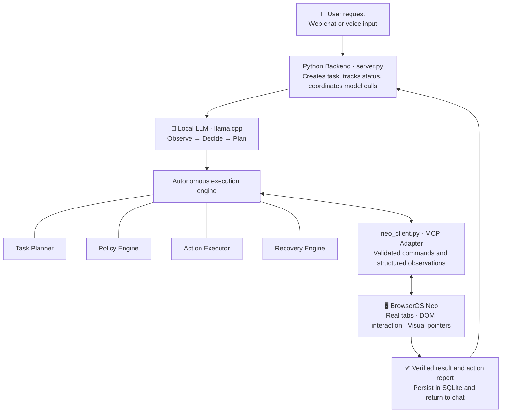
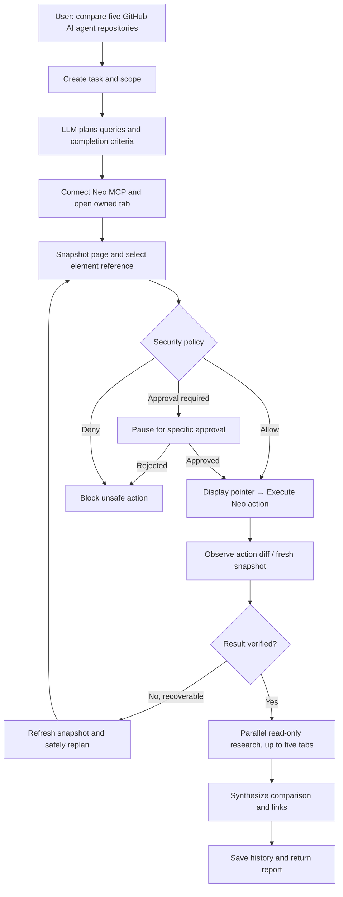
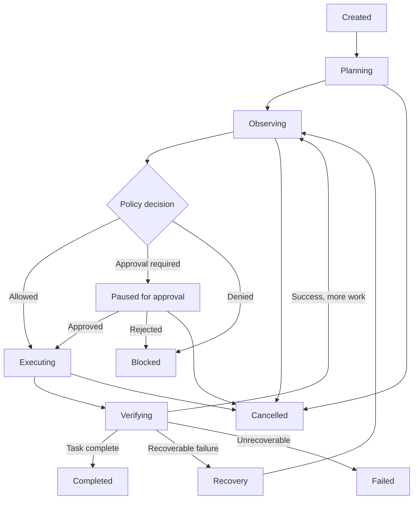
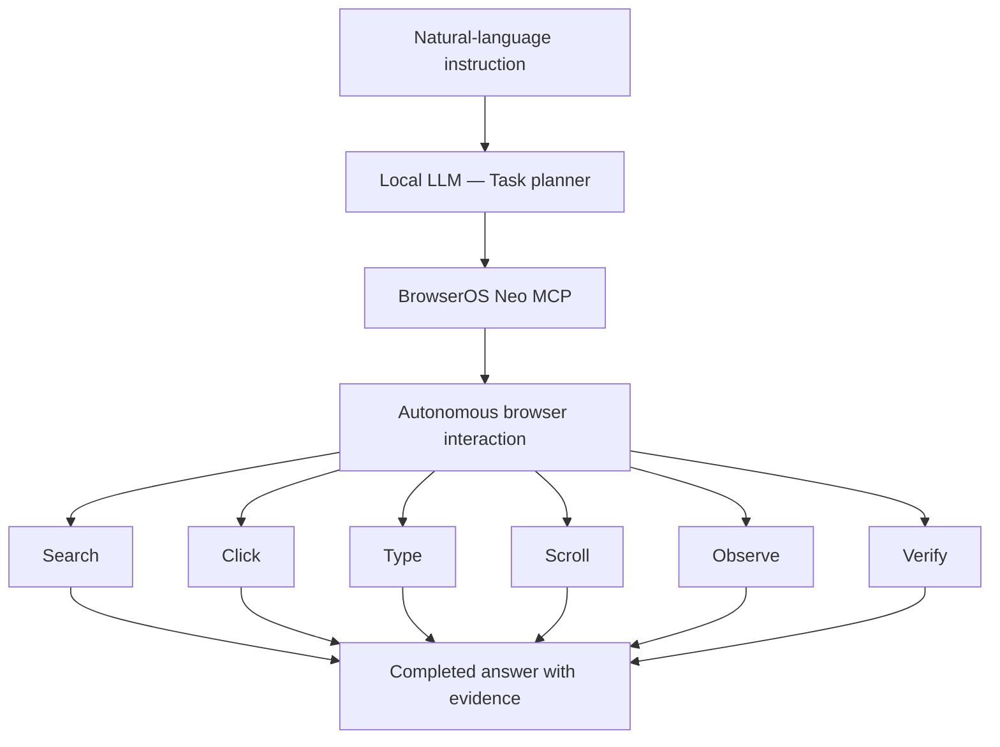

# BrowserOS Neo — High-Autonomy Implementation Blueprint

> **Implementation status — 9 November 2026:** Implemented in the existing application. See [delivery report, verification and boundaries](../docs/AUTONOMOUS_BROWSER_IMPLEMENTATION.md). This original design is retained as the specification; the report records deliberate choices such as explicit Browser mode, compact task records, polling, sequential protected interactions and safe pauses after lost tab ownership. Broad model benchmarking and live consequential-account tests were not performed.

> **Architecture design · Version 2.0**
>
> **Goal:** Upgrade your existing Windows local AI assistant into an autonomous browser agent that can operate BrowserOS Neo, visually indicate what it is doing, interact with websites, recover from errors, and finish multi-step tasks with minimal intervention.
>
> We will **keep your existing Python backend, llama.cpp inference, SQLite conversations, and BrowserOS Neo MCP connection**. This is an extension of your application, not a rebuild.

---

## 1. Target capabilities

### Autonomous Browser Agent

| Capability | Target behavior |
|---|---|
| **Navigate** | Open pages and switch tabs |
| **Visual pointer** | Show the target of each click |
| **Type and fill** | Search bars and web forms |
| **Observe** | Read live page snapshots |
| **Explore** | Scroll and inspect pages |
| **Recover** | Replan after failed actions |
| **Multi-tab** | Research up to five tabs |
| **Verify** | Check final website state |

Normal website exploration, searching, scrolling, clicking, and typing will happen automatically. Consequential operations such as sending emails, publishing, payments, deleting content, or modifying sensitive account settings will be handled by a separate policy and approval layer.

---

## 2. Proposed system architecture



### Visual stacked architecture (text equivalent)

```text
┌───────────────────────────────────────────────────────────┐
│  👤 USER REQUEST                                          │
│  Web chat or voice input                                  │
└────────────────────────────┬──────────────────────────────┘
                             ↓
┌───────────────────────────────────────────────────────────┐
│  Python Backend · server.py                               │
│  Creates task, tracks status, coordinates model calls     │
└────────────────────────────┬──────────────────────────────┘
                             ↓
┌───────────────────────────────────────────────────────────┐
│  🧠 Local LLM · llama.cpp                                 │
│  Observe → Decide → Plan                                  │
└────────────────────────────┬──────────────────────────────┘
                             ↓
┌───────────────────────────────────────────────────────────┐
│  AUTONOMOUS EXECUTION ENGINE                              │
│  ┌───────────────────────┬──────────────────────────────┐  │
│  │ Task Planner          │ Policy Engine                │  │
│  ├───────────────────────┼──────────────────────────────┤  │
│  │ Action Executor       │ Recovery Engine              │  │
│  └───────────────────────┴──────────────────────────────┘  │
└────────────────────────────┬──────────────────────────────┘
                             ↕
┌───────────────────────────────────────────────────────────┐
│  neo_client.py · MCP Adapter                              │
│  Validated commands and structured observations           │
└────────────────────────────┬──────────────────────────────┘
                             ↕
┌───────────────────────────────────────────────────────────┐
│  🖥️ BrowserOS Neo                                        │
│  Real tabs · DOM interaction · Visual pointers            │
└────────────────────────────┬──────────────────────────────┘
                             ↓
┌───────────────────────────────────────────────────────────┐
│  ✅ Verified result and action report                     │
│  Persist in SQLite and return to chat                     │
└───────────────────────────────────────────────────────────┘
```

The important architectural decision is to keep the model responsible for deciding *what to do*, while your Python backend decides *whether the action is allowed* and BrowserOS Neo handles *how the browser action is executed*.

---

## 3. BrowserOS Neo integration: what is actually supported?

Neo provides MCP tools including `tabs`, `navigate`, `snapshot`, `act`, and `run`.

The official workflow is based on reading page accessibility snapshots, identifying element references, acting on those references, and checking the returned page changes. For multi-step operations, BrowserOS recommends composing bounded operations with `run`.

### Keep your current MCP connection

Your review documents Neo settings using proxy port `9010`, server port `9210`, and CDP port `9110`. Those are the settings observed in your local environment; they should not be treated as universal defaults.

Neo's public documentation often illustrates an endpoint such as `http://127.0.0.1:9200/mcp`, but advises reading the active URL from Neo's MCP page because ports can vary.

**Recommended configuration:**

```env
NEO_MCP_URL=http://127.0.0.1:9210/mcp
NEO_AGENT_NAME=local-assistant
NEO_BROWSER_MODE=autonomous
NEO_REQUIRE_APPROVAL_FOR_SENSITIVE=true
NEO_MAX_PARALLEL_TABS=5
NEO_MAX_ACTION_RETRIES=2
NEO_VISUAL_POINTER=true
```

The `9210` endpoint is a configuration candidate based on your report, **not a verified live MCP URL**. Copy the real URL from Neo before saving the file. These environment variable names are part of the proposed design, not existing app settings.

### Tool routing

| Action | Preferred Neo mechanism |
|---|---|
| Create and list tabs | `tabs` |
| Open URL | `navigate` or `run` |
| Inspect interactive elements | `snapshot` |
| Click, fill, press, select | `act` |
| Multi-step browser workflow | `run` |
| Read page content | Neo read operations |
| Check action result | Action diff or fresh snapshot |
| Visual pointer animation | Custom application overlay |

For example, a search task should not rely on the model guessing that the search box is at coordinate `(420, 180)`. It should retrieve the page snapshot, identify the actual search field, and use its current reference.

This makes the automation more resistant to screen resolution changes, browser zoom, and responsive layouts.

---

## 4. Exact module changes

The following is the proposed target implementation, based on the responsibilities described in your uploaded project review. Since the full repository source is not attached, these are module-level changes and integration contracts, not line-numbered patches.

### `neo_client.py` — Upgrade existing MCP adapter

Keep connection and session management. Add typed wrappers for tab creation, navigation, snapshots, actions, page reading, and execution results. Discover the installed Neo tool schemas on connection rather than assuming every version exposes identical arguments.

Return structured results containing the tab, current URL, action outcome, page change, error, and available element references.

### `chat_tools.py` — Replace broad model-facing execution with validated actions

Add a strict `browser_action` tool interface for normal LLM decisions. Continue supporting the existing Neo integration, but ensure untrusted model output cannot directly invoke arbitrary browser SDK JavaScript or bypass your permission checks.

The backend can still use Neo's `run` internally for validated, bounded batches.

### `server.py` — Integrate autonomous orchestration

Replace the fixed browser tool-loop behavior for autonomous tasks with a resumable task controller. Preserve ordinary chat responses.

Support task creation, progress events, approval responses, cancellation, recovery, and final verification.

### `parallel_browser.py` — Improve parallel tasks and visual pointer overlays

Maintain the existing maximum of five concurrent browser jobs. Associate each job with its own tab and visual indicator.

Enhance hover, click, typing, and scroll animations. Avoid moving the actual Windows cursor unless desktop automation is added later.

### `chat_store.py` — Persist task execution

Extend SQLite storage with separate task, step, approval, and event records. Preserve the existing conversations and backup behavior.

Ensure a restart can identify incomplete actions without blindly submitting them again.

### `public/app.js` and `public/style.css` — Live agent monitor

Show current website, active action, progress, pending approval, Stop button, and recent action history.

Use server-sent events or a bounded polling endpoint for updates. The existing non-streaming model replies can remain unchanged initially.

### New modules to create

```text
project/
├── server.py                 # Existing: API and orchestration
├── chat_tools.py             # Existing: model tools
├── neo_client.py             # Existing: MCP connection
├── parallel_browser.py       # Existing: multi-tab execution
├── chat_store.py             # Existing: persistence
├── model_runtime.py          # Existing: local model management
│
├── agent/
│   ├── __init__.py
│   ├── task_manager.py       # Task lifecycle and state
│   ├── planner.py            # LLM action selection
│   ├── browser_executor.py   # Validated Neo actions
│   ├── policy.py             # Security and approval decisions
│   ├── verifier.py           # Check expected outcomes
│   ├── recovery.py           # Handle failure/replanning
│   └── events.py             # Progress/event protocol
│
├── public/
│   ├── app.js
│   ├── style.css
│   ├── agent-monitor.js      # Live progress UI
│   └── agent-monitor.css
│
└── tests/
    ├── test_agent_policy.py
    ├── test_browser_executor.py
    ├── test_agent_recovery.py
    └── test_task_lifecycle.py
```

---

## 5. Browser action contract

Instead of giving the local LLM unrestricted JavaScript execution, expose a small, clearly defined action schema.

```python
from enum import Enum
from pydantic import BaseModel, Field

class BrowserActionType(str, Enum):
    NEW_TAB = "new_tab"
    NAVIGATE = "navigate"
    SNAPSHOT = "snapshot"
    READ = "read"
    CLICK = "click"
    FILL = "fill"
    PRESS = "press"
    SCROLL = "scroll"
    SELECT = "select"

class BrowserAction(BaseModel):
    action: BrowserActionType
    tab_id: str | None = None
    url: str | None = None
    ref: str | None = None
    value: str | None = None
    expected_result: str | None = None

class BrowserStepResult(BaseModel):
    success: bool
    tab_id: str | None = None
    current_url: str | None = None
    observation: str = ""
    error: str | None = None
    verified: bool = False
```

Use this as the model-facing contract. The executor must validate which fields are permitted for each action and translate them into the actual Neo MCP tool inputs.

For example, the model can select:

```json
{
  "action": "fill",
  "tab_id": "agent-tab-1",
  "ref": "e12",
  "value": "open source desktop AI agents",
  "expected_result": "Search field contains query"
}
```

`agent-tab-1` and `e12` are illustrative identifiers. In real execution, both must come from the current browser state.

The executor should reject references that were not observed in the selected tab and refresh the snapshot if the reference becomes stale.

---

## 6. High-autonomy permission engine

This is the most important new module because your current report identifies no enforced approval checkpoint before browser submissions.

I recommend three action classes.

| Class | Examples | Behavior |
|---|---|---|
| Automatic | Search, navigate, read, scroll, open tabs, non-sensitive form exploration | Execute |
| Protected | Send email, publish, modify a record, upload a private file, submit an application | Require explicit approval |
| Restricted | Payments, credential changes, security-setting changes, bulk deletion, sharing sensitive information | Block by default or require a dedicated, narrowly scoped authorization flow |

Typing is not always harmless. Typing a private password or personal information into an unexpected site is materially different from typing a search query. Likewise, clicking a button can be a read-only navigation or a destructive action.

The policy must consider the URL, action type, target element, submitted content, and likely side effects—not merely whether the action is named `click`.

### Proposed policy function

```python
from enum import Enum

class Decision(str, Enum):
    ALLOW = "allow"
    APPROVAL = "approval"
    DENY = "deny"

def evaluate_action(action, context) -> Decision:
    # context is assembled by the trusted backend.
    if context.is_internal_or_unsafe_url:
        return Decision.DENY

    if context.is_credential_or_security_change:
        return Decision.DENY

    if context.is_payment_or_destructive_action:
        return Decision.APPROVAL

    if context.is_external_submission:
        return Decision.APPROVAL

    if context.exposes_sensitive_information:
        return Decision.APPROVAL

    if context.action_classification_uncertain:
        return Decision.APPROVAL

    return Decision.ALLOW
```

This is a policy skeleton, not a complete security implementation. For production behavior, enforce URL checks against localhost, private networks, metadata services, and unsafe schemes; recheck redirects; inspect form destinations; and prevent encoded or indirect requests from bypassing the policy.

Crucially, **approval must be enforced by the backend**, never just requested in the system prompt.

For high-autonomy browsing, allow the model to do routine exploration without asking. Before a protected action, pause and show exactly what will happen, which account and site will be affected, and the content or changes being submitted.

The actual action should run only after the backend receives a valid approval tied to that exact operation.

---

## 7. Visible cursor overlay system

You specifically want to watch the AI operate Neo—pointer moving, clicking elements, entering text, and proceeding to the next action.

Here's an illustrative appearance for the visible interaction layer.

### Visual browser mockup (Markdown-compatible rendering)

```text
┌─────────────────────────────────────────────────────────────┐
│ 🌐 BrowserOS Neo · Agent tab                 [Illustration] │
├─────────────────────────────────────────────────────────────┤
│ 🔒 github.com/search?q=ai+agents                            │
│                                                             │
│                    Search repositories                      │
│                                                             │
│    ╔═══════════════════════════════════════════════════╗    │
│    ║ AI desktop agents                              🔍 ║    │
│    ╚═══════════════════════════════════════════════════╝    │
│                                      ↖                      │
│                              🖱 Agent targeting search      │
│                                                             │
├─────────────────────────────────────────────────────────────┤
│ ● Current action: Fill search field                          │
└─────────────────────────────────────────────────────────────┘
```

**This is a UI concept, not a live screenshot or a verified Neo rendering.**

### Recommended implementation

Keep the existing pointer rendering in `parallel_browser.py` as the starting point.

When the model selects an element reference, the backend should resolve its position through a supported Neo mechanism, emit an overlay event, and then execute the action.

```text
1. Agent receives page snapshot
2. Model selects element reference
3. Backend validates action
4. Resolve element position
5. Display pointer animation
6. Execute native Neo action
7. Receive action diff
8. Verify expected result
9. Remove or move overlay
```

### Pointer features

- **Hover:** smooth pointer movement to the target.
- **Click:** small pulse or ring around the selected element.
- **Typing:** focus highlight around the active input.
- **Scrolling:** unobtrusive directional indicator.
- **Error:** briefly highlight the failed target.
- **Parallel tasks:** give each task a distinct indicator.

Implement overlays using a supported Neo/CDP rendering mechanism, or a page overlay only where that approach is permitted and reliable. Avoid introducing arbitrary page JavaScript just for decorations if Neo already exposes a supported pointer mechanism.

Because the actual input is dispatched through the browser automation API, the visible cursor is a representation of that input—not the physical OS cursor moving over your desktop.

---

## 8. End-to-end task execution

Consider this instruction:

> Open GitHub, find five local AI agent repositories, compare their capabilities, and show the best two.

### Step 1 — Task creation

`task_manager.py` creates a task ID, records the request and allowed scope, and opens a task execution record.

### Step 2 — Planning

`planner.py` identifies the target website, search queries, information to extract, and completion criteria.

### Step 3 — Browser session

`neo_client.py` establishes the MCP session, names the task, and creates a dedicated Neo tab.

### Step 4 — Autonomous actions

The agent navigates, reads a snapshot, selects the search field, types the query, submits it, and observes the results. It can repeat these steps without asking for each click.

### Step 5 — Parallel research

`parallel_browser.py` opens separate task tabs and collects independent repository information with at most five concurrent browser jobs.

### Step 6 — Verification and recovery

Check that the expected pages and information were actually retrieved. On a stale reference or changed layout, take a fresh snapshot and retry only when the action is safe to repeat.

### Step 7 — Final response

Summarize the five repositories, compare their verified capabilities, include source URLs, and save the task history.

### End-to-end execution flow diagram



---

## 9. State management and recovery

The current project limits tool use to 10 rounds of up to four tool calls, and uses one llama.cpp generation slot. That is sufficient for short browsing jobs but restrictive for longer autonomous work.

I would introduce an explicit task state machine:



Cancellation must be checked between operations. For very long actions, the agent should stop after the current bounded Neo operation if immediate cancellation is unavailable.

### Failure handling

| Failure | Recovery |
|---|---|
| Element reference stale | Take a new snapshot |
| Navigation failure | Inspect error, retry only when safe |
| Neo disconnected | Pause task and request reconnection |
| Model returned invalid action | Validate, reject, and replan |
| Login or CAPTCHA required | Hand control to user |
| Website action may have succeeded before timeout | Inspect actual website state before retry |
| Task exceeded limits | Save state and stop or request continuation |

Neo also documents `request_human_help` and `await_human_help` for situations such as sign-in, CAPTCHA, and user intervention. Use those when the installed server exposes them.

The 30-second Neo `run` limit is especially important: longer tasks must be divided into bounded batches, not placed inside one enormous script.

---

## 10. Data persistence

Add the following logical records to SQLite:

| Record | Important fields |
|---|---|
| `agent_tasks` | ID, session ID, request, state, timestamps |
| `agent_steps` | Task ID, step number, action, result, verification |
| `agent_approvals` | Task ID, action fingerprint, decision, expiry |
| `agent_events` | Task ID, sequence, event type, sanitized details |
| `agent_tabs` | Task ID, Neo tab ID, URL, ownership |

Use SQLite transactions for important state transitions. For external website mutations, record an *intent* before execution, then record the observed outcome afterward.

Do not interpret the absence of a successful response as proof that a click or submission failed.

Persist task metadata and sanitized evidence. Avoid saving passwords, one-time codes, cookies, full session headers, or unnecessary private page content.

---

## 11. Required API endpoints

Extend `server.py` with the following proposed routes.

| Endpoint | Purpose |
|---|---|
| `POST /api/agent/tasks` | Create autonomous task |
| `GET /api/agent/tasks/{id}` | Retrieve task status |
| `GET /api/agent/tasks/{id}/events` | Stream progress |
| `POST /api/agent/tasks/{id}/approve` | Approve specific protected action |
| `POST /api/agent/tasks/{id}/reject` | Reject protected action |
| `POST /api/agent/tasks/{id}/cancel` | Stop task execution |
| `POST /api/agent/tasks/{id}/resume` | Resume recoverable task |
| `GET /api/agent/neo/status` | Inspect MCP connectivity |

The live monitor should show task progress even when a model response is still being generated. SSE is a reasonable first choice because browser progress primarily travels from backend to frontend.

---

## 12. Local model compatibility

Your uploaded review lists four configured models.

| Model | Tool support in current app | Proposed usage |
|---|---|---|
| Qwen3.5 4B Q4_K_M | Enabled | Fast, simple actions |
| Qwen3.5 9B Q4_K_M | Enabled | Main agent candidate |
| WizardLM 7B Q4_K_M | Disabled | Conversation only |
| Qwen3 30B A3B IQ3_XS | Enabled | More complex planning candidate |

**Start by evaluating Qwen3.5 9B for autonomous browsing.** It is a reasonable initial candidate, but the review did not benchmark model reliability, so don't assume it will be better than 4B or 30B for every browser task.

Also, your current 2,048-token per-call output limit and character-based conversation summarization need careful handling. Keep browser observations compact, use structured action schemas, and evaluate model-specific context budgets.

The agent should never be able to bypass the policy layer simply because a model produces executable-looking code.

---

## 13. Implementation roadmap

### Development checklist

#### Phase 1 — Neo connection and tool validation

- [ ] Verify active MCP endpoint and available schemas
- [ ] Implement typed Neo adapter
- [ ] Run snapshot, click, fill, and navigation smoke tests

#### Phase 2 — Autonomous control

- [ ] Create planner and action executor
- [ ] Add observe → act → verify loop
- [ ] Implement task states and recovery

#### Phase 3 — Visual browser interactions

- [ ] Render pointer target overlays
- [ ] Add click, fill, and scroll feedback
- [ ] Display task progress in chat UI

#### Phase 4 — Permissions and persistence

- [ ] Enforce protected-action approvals
- [ ] Implement restricted URL and data policies
- [ ] Persist and safely resume tasks

#### Phase 5 — Reliability testing

- [ ] Test multi-tab research
- [ ] Test stale references, timeouts, and cancellation
- [ ] Benchmark all tool-enabled models

---

## 14. Acceptance tests before release

The implementation should pass these scenarios:

1. **Google search:** autonomously open a tab, search, inspect results, and provide links.
2. **GitHub research:** open multiple tabs, compare repositories, and verify information.
3. **Form entry:** fill a form without submitting protected data.
4. **Approval:** pause before sending a message or making a consequential change.
5. **Failure recovery:** handle a missing element, stale reference, and Neo disconnection.
6. **Cancellation:** stop creating new actions when the user presses Stop.
7. **Restart recovery:** do not duplicate a previously submitted website action.
8. **Security:** reject disallowed destinations, sensitive data exfiltration, and malicious instructions embedded in webpages.

### Final architecture decision

**✅ Reuse existing:** Python backend, llama.cpp, SQLite, BrowserOS Neo, MCP connection, and parallel browser functionality.

**➕ Build next:** Autonomous planner, validated browser executor, enforced permission engine, task state machine, visual pointer enhancements, and live progress monitoring.

**🛡️ Operating principle:** High autonomy for browser exploration, with enforceable boundaries around sensitive and consequential actions.

This blueprint is ready to use as the specification for your coding agent. It is not yet an implemented change to your repository.

**My recommended first implementation milestone:** Get the agent to autonomously open Neo, perform a search, click a result, read the page, and verify its actions, with visible pointer feedback and a functioning Stop control. Once that is reliable, extend the same engine to multi-tab and account-based workflows.

### Official references

- [BrowserOS Neo agent skill](https://github.com/browseros-ai/BrowserOS/blob/main/skills/browseros-neo/SKILL.md)
- [Neo manual MCP integration](https://docs.browseros.com/neo/mcp/manual)

---

## Supplement: Original concept and autonomy selection context

The blueprint above reproduces the fourteen numbered sections and technical substance of the displayed design. This supplement preserves the additional browser-control concept explained immediately before that design, including the requested automatic pointer behavior and autonomy modes.

### What you asked the agent to do

- Open BrowserOS Neo and navigate to any permitted website.
- Find buttons, input fields, links, search bars, and menus automatically.
- Move a visible pointer to the target and click without manual intervention.
- Type search queries, fill forms, scroll, and interact with pages.
- Observe what happened after each action and correct mistakes.
- Continue through multiple steps until the requested task is completed.

You should not have to issue separate commands for every click. The model should decide and carry out necessary intermediate steps itself.

### Conceptual request-to-result flow



### Example user request

> Open GitHub, search for the best open-source AI desktop agents, inspect five repositories, compare their features, and give me a report.

### Browser pointer versus Windows cursor

BrowserOS Neo can display visual pointer overlays on webpages, but that is different from moving your actual Windows system mouse.

Your reviewed project already contains pointer-rendering functionality in `parallel_browser.py`. According to that report, those colored pointers are browser-page overlays, not native Windows cursors.

We can build on this to make automation visibly understandable:

1. Highlight the element the AI selects.
2. Display an animated pointer near the element.
3. Click or type using Neo's browser automation API.
4. Show the action being performed.
5. Verify the page changed as expected.

For native Windows cursor movement, a separate desktop-control integration would be required. For browser-only automation, Neo's existing tools are the better foundation.

### Original quick implementation idea (conceptual pseudocode)

```python
async def execute_browser_task(user_request):
    task = await planner.create_task(user_request)

    while not task.completed:
        observation = await neo.observe_page()

        action = await planner.next_action(
            task=task,
            observation=observation
        )

        if action.is_sensitive:
            await require_user_approval(action)

        result = await neo.execute(action)

        await task.record(action, result)

        if not result.success:
            await planner.recover(task, result)

    return await planner.summarize(task)
```

This is architectural pseudocode, not a drop-in replacement for the current Neo client. The `planner`, `neo`, and approval functions must be connected to the real implementations.

### Autonomy modes discussed

| Mode | Meaning |
|---|---|
| **Supervised** | Ask before every browser interaction. |
| **Autonomous — recommended default** | Navigate, search, click, type, and read automatically; ask before consequential actions. |
| **Unrestricted — user selected high-autonomy direction** | No routine confirmation, including website submissions; higher risk. Preserve essential safety restrictions for payments, account changes, destructive actions, and access to sensitive data. |

The selected implementation direction is **high autonomy with essential safety restrictions**, represented by the approval policy in Section 6.

### Existing versus improved behavior

The application already registers Neo through `chat_tools.py`, launches SDK scripts through `neo_client.py`, and supports concurrent browser tasks.

However, the source review did not establish that a complete live browser workflow succeeds with the currently selected local model.

The first end-to-end test should be: open a new Neo tab, search Google, click a result, read the page, navigate back, and summarize the findings. Once that works reliably, expand to multi-page tasks, forms, and advanced interactions.

**Ultimate objective:** You give one instruction, and the assistant independently plans and executes the browser workflow while you watch cursor indicators, clicks, typing, and navigation happen in BrowserOS Neo.
