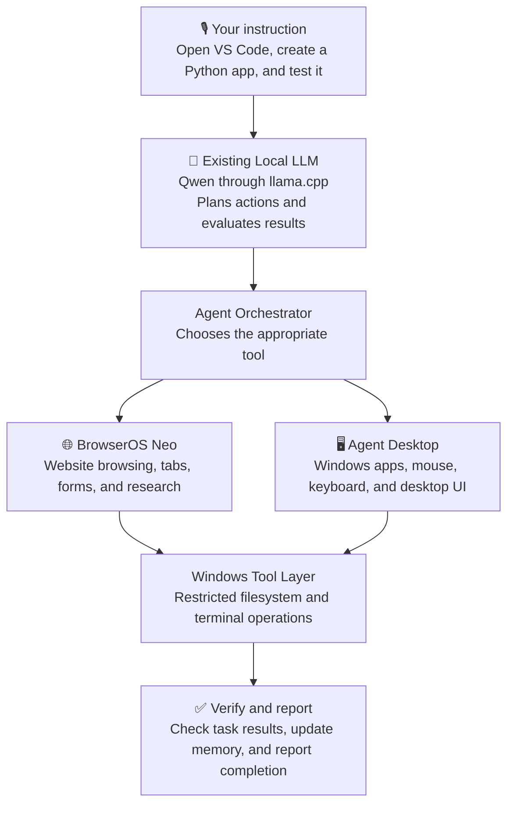
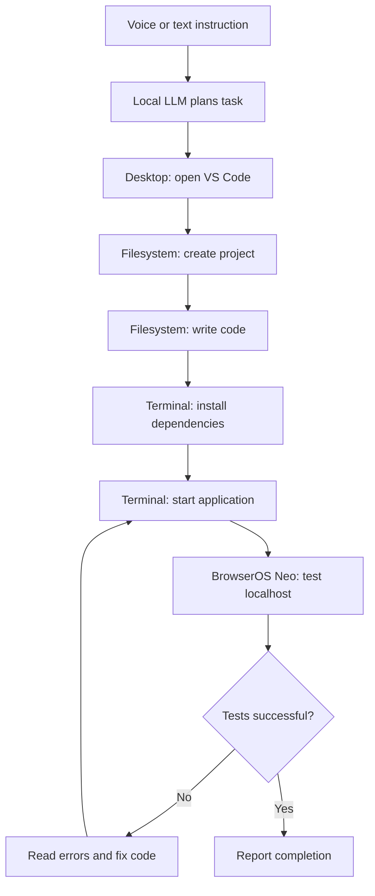

# GitHub Analysis: Vercel Agent Desktop → Your Windows AI Assistant

**Status:** Highly relevant · Windows supported · Open source  
**Source repository:** [vercel-labs/agent-desktop](https://github.com/vercel-labs/agent-desktop)  
**Analysis date:** 10 November 2026  
**Purpose:** Evaluate Vercel's Agent Desktop for adding desktop control, typing, mouse control, a visible second agent cursor, and autonomous task execution to your existing Windows local AI assistant.

---

**Yes. This repository is directly relevant to what you're trying to build.** It provides much of the missing desktop-control layer in your existing AI assistant.

I inspected the source repository: [vercel-labs/agent-desktop](https://github.com/vercel-labs/agent-desktop).

The key discovery is that `agent-desktop` is **not another AI model**. It's a computer-control toolkit that lets an AI agent observe and interact with native desktop applications.

It supports Windows, macOS, and Linux, and exposes commands through a CLI, an MCP server, and a native C library.

## 1. What can it do for your app?

| Your desired feature | Agent Desktop capability |
|---|---|
| See open Windows applications | ✅ Accessibility snapshots |
| Click buttons and controls | ✅ Click element references |
| Type code and text | ✅ Type and set-value |
| Use keyboard shortcuts | ✅ Press commands |
| Move the mouse | ✅ Mouse movement and clicks |
| Launch applications | ✅ Launch commands |
| Control VS Code | ✅ Supported through desktop interactions |
| Observe the screen | ✅ UI tree and optional screenshots |
| Display an agent cursor | ✅ Cursor-overlay functionality |
| Independently plan tasks | ❌ Requires your AI agent |

The biggest advantage is that **you don't need to build low-level Windows mouse and keyboard automation from scratch**.

Your existing assistant can provide the reasoning and task planning. Agent Desktop can provide the Windows application interactions.

Source: [Repository README and command reference](https://github.com/vercel-labs/agent-desktop/blob/main/README.md).

---

## 2. The biggest discovery: It already has a secondary cursor!

This is particularly interesting for your idea.

The repository contains a built-in **`cursor-overlay`** system with animated movement, click ripples, target highlighting, typing caret indicators, custom colors, and even multiple agent cursors.

### Two operating modes

| Headless mode | Headed mode |
|---|---|
| 🖱️ **Agent overlay + semantic action** | 🖱️ **Physical mouse/keyboard input** |
| The AI controls supported application elements through accessibility APIs without moving your real mouse. Its own cursor overlay can show the activity. | The AI can move the actual mouse and synthesize keyboard input for interactions requiring physical control. |

**Important:** The overlay is a visual second pointer, not a second independent Windows hardware cursor. Headless accessibility actions can happen while you use the desktop. Headed physical actions share your actual cursor, keyboard focus, and foreground desktop, so they can interfere with your work.

This distinction is confirmed by the repository's:

- [Headed mode documentation](https://github.com/vercel-labs/agent-desktop/blob/main/apps/docs/content/docs/guides/headed-mode.mdx)
- [Cursor overlay documentation](https://github.com/vercel-labs/agent-desktop/blob/main/apps/docs/content/docs/commands/system.mdx)

---

## 3. How I would integrate it into your assistant

Don't replace BrowserOS Neo. **Combine both technologies.**

### Visual architecture diagram



### Same architecture, in text form

```text
Your instruction
  "Open VS Code, create a Python app, and test it"
                       │
                       ▼
             Existing Local LLM
              Qwen / llama.cpp
      Plans actions and evaluates results
                       │
                       ▼
              Agent Orchestrator
        Chooses the appropriate tool
                 ┌─────┴─────┐
                 ▼           ▼
           BrowserOS Neo  Agent Desktop
           Web browsing   Windows desktop
           Tabs, forms    Mouse, keyboard,
           and research   native app UI
                 └─────┬─────┘
                       ▼
              Windows Tool Layer
       Restricted filesystem and terminal
                       │
                       ▼
                Verify and report
        Check task results, update memory,
              and report completion
```

The Windows Tool Layer is my proposed addition, not a component provided by Agent Desktop.

---

## 4. Source code worth studying and reusing

I examined the repository's Rust source layout and implementation documentation.

| GitHub source | Why it matters |
|---|---|
| [Windows adapter](https://github.com/vercel-labs/agent-desktop/tree/main/crates/windows/src) | Uses Windows UI Automation to inspect native app controls |
| [Keyboard and mouse input](https://github.com/vercel-labs/agent-desktop/tree/main/crates/windows/src/input) | Includes Windows input synthesis and handling |
| [Desktop actions](https://github.com/vercel-labs/agent-desktop/tree/main/crates/windows/src/actions) | Element selection, input delivery, and action handling |
| [MCP implementation](https://github.com/vercel-labs/agent-desktop/tree/main/src/mcp) | Exposes desktop commands to AI agents |
| [Cursor overlay configuration](https://github.com/vercel-labs/agent-desktop/tree/main/src/cli_args) | Includes animation and visual pointer settings |

You don't need to rewrite these Rust components into Python. The project is Apache-2.0 licensed and already packages its native functionality for external use.

For your application, **MCP integration is the cleanest approach**.

---

## 5. Quick Windows experiment

From PowerShell:

```powershell
npm install -g agent-desktop

# Check supported desktop operations
agent-desktop status

# Create a session with visual cursor
agent-desktop session start --cursor

# Inspect active applications
agent-desktop list-apps

# Open Notepad
agent-desktop launch notepad

# Read its controls
agent-desktop snapshot --app notepad.exe -i
```

The snapshot returns references to detected application elements. You can then use the returned full reference for operations such as:

```powershell
agent-desktop set-value '@SNAPSHOT_ID:e1' "Hello from my AI assistant"
```

Replace `@SNAPSHOT_ID:e1` with a real editable-element reference from the snapshot. Not every application exposes `SetValue` on its text editor.

### MCP integration

The project already provides:

```json
{
  "mcpServers": {
    "agent-desktop": {
      "command": "agent-desktop",
      "args": ["mcp"]
    }
  }
}
```

For your Python backend, start this MCP server over stdio and register only the tools your agent is allowed to use.

The MCP server exposes tools such as `desktop_snapshot`, `desktop_click`, and `desktop_session_start`, with structured JSON results.

See the [MCP integration source documentation](https://github.com/vercel-labs/agent-desktop/blob/main/apps/docs/content/docs/guides/mcp.mdx).

---

## 6. Example: Your assistant writes code autonomously

Imagine you say:

> Open VS Code, create a folder called AI-Project, write a FastAPI application, install the dependencies, run it, and check whether the server works.

The workflow should be:



This is more robust than forcing the AI to type hundreds of lines with keyboard simulation.

For actual coding, I recommend using direct, restricted file operations to create and edit code, and terminal tools to run tests. Use Agent Desktop to operate VS Code visually, interact with dialogs, open windows, and verify the result.

The AI can still type directly into an editor when necessary, but desktop accessibility varies by application. VS Code's editor may require keyboard-based interaction rather than semantic text insertion.

---

## 7. What changes in your existing project?

| Existing/new module | Responsibility |
|---|---|
| `server.py` | Coordinate desktop and browser task execution |
| `chat_tools.py` | Register approved desktop tool schemas |
| `neo_client.py` | Keep BrowserOS Neo unchanged |
| `desktop_client.py` — new | Connect to Agent Desktop MCP |
| `desktop_policy.py` — new | Restrict sensitive operations |
| `task_planner.py` — new | Break instructions into steps |
| `task_executor.py` — new | Route steps to appropriate tools |
| `desktop_memory.py` — new | Store task progress and reusable context |

Your safety layer should allow routine reading and navigation while requiring approval for deletion, payments, sending messages, modifying account settings, and risky shell commands.

Also, Windows imposes some real boundaries: Agent Desktop cannot control UAC's secure desktop, a locked computer, the sign-in screen, or another user's session. Elevated applications have additional permission restrictions.

---

## 8. What I recommend building first

### Phase 1 — Desktop integration

Connect Agent Desktop over MCP. Test Notepad, Calculator, File Explorer, and VS Code using snapshots and semantic clicks.

### Phase 2 — Secondary cursor

Enable the virtual cursor overlay, animation, highlights, and task labels. Use headed mode only when physical input is needed.

### Phase 3 — Coding and terminal automation

Add safe project-scoped file editing, terminal execution, test monitoring, and automatic error correction.

### Phase 4 — Autonomous workflows

Combine BrowserOS Neo and Agent Desktop under one planner with persistent tasks, retries, approvals, and cancellation.

---

## Final assessment

**Feasible for your existing application.**

The repository provides a practical desktop automation engine, including Windows UI Automation, MCP tools, physical input support, and virtual cursor overlays.

**The combination I would choose:**

> **Local Qwen + BrowserOS Neo + Vercel Agent Desktop + restricted filesystem/terminal tools + autonomous planner.**

The most useful discovery is that **you can build the secondary-cursor experience using functionality the repository already provides**, rather than engineering an overlay from scratch.

The remaining major challenge is the intelligence and reliability of your agent: deciding which application to use, executing actions in order, interpreting failures, checking results, and respecting approval boundaries.

With those components, your assistant could become a genuine Windows computer-use agent—one that can research, operate applications, write and test code, and carry out complex tasks from natural-language instructions. It won't literally be capable of every conceivable desktop action, but the architecture supports a substantial portion of what you're describing.

---

## References

- [vercel-labs/agent-desktop — GitHub repository](https://github.com/vercel-labs/agent-desktop)
- [README and command reference](https://github.com/vercel-labs/agent-desktop/blob/main/README.md)
- [Windows adapter implementation](https://github.com/vercel-labs/agent-desktop/tree/main/crates/windows/src)
- [Windows keyboard and mouse input implementation](https://github.com/vercel-labs/agent-desktop/tree/main/crates/windows/src/input)
- [Windows desktop action implementation](https://github.com/vercel-labs/agent-desktop/tree/main/crates/windows/src/actions)
- [MCP tool implementation](https://github.com/vercel-labs/agent-desktop/tree/main/src/mcp)
- [Cursor overlay configuration](https://github.com/vercel-labs/agent-desktop/tree/main/src/cli_args)
- [Headed mode reference](https://github.com/vercel-labs/agent-desktop/blob/main/apps/docs/content/docs/guides/headed-mode.mdx)
- [Cursor overlay/system commands reference](https://github.com/vercel-labs/agent-desktop/blob/main/apps/docs/content/docs/commands/system.mdx)
- [MCP integration guide](https://github.com/vercel-labs/agent-desktop/blob/main/apps/docs/content/docs/guides/mcp.mdx)
